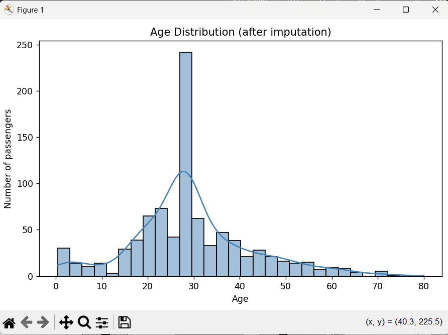

# Titanic Data Cleaning Project

Cleans the Titanic dataset using Pandas: fills missing Age (median) and Embarked (mode), drops Cabin, encodes Sex with LabelEncoder and Embarked with OneHotEncoder, and plots the age distribution.

## Files
- [`titanic.py`](titanic.py): the full script
- [`titanic_cleaned.csv`](titanic_cleaned.csv): the cleaned dataset
- [`age_distribution.png`](age_distribution.png): age histogram

## How to run
1. Place `train.csv` in the same folder as `titanic.py`.
2. Run `python titanic.py`.
